# The Iron Throne

*Doom proposes. The council approves.*

<p align="center">
  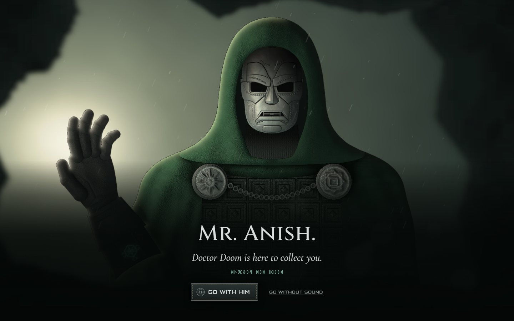
</p>

> **By the will of Victor von Doom, Sovereign of Latveria, to whoever holds this repository: greeting.**
>
> Doom does not attend the cinema. Doom *convenes* it. When *Avengers: Doomsday* reaches the screen, he will not sit among strangers. He will arrive with a company of his own choosing, each member named, summoned and seated by his hand. That company is yours to gather. Give each friend a private link and let them be collected. Let them claim a mantle no other may wear, and weigh the day, the hour and the hall you set before them. Their approval is counsel; the decree is yours.
>
> Doom has chosen you to do the choosing. He expects it done well.

The Iron Throne is a private, cinematic invitation website for a group trip to see *Avengers: Doomsday*. Each guest opens a personal link and is collected by Doctor Doom in an animated opening. They receive a royal summons from Latveria, accept or decline, claim a character (a "mantle") that nobody else can hold, and approve the date, time and venue you propose or suggest another. When you're ready, you decree the plan.

The experience is played completely straight: the guest is a recruit, the invitation is a state document, and the planning screen is a council chamber. The humour comes from how seriously Doom takes a cinema trip.

> [!NOTE]
> This is an unofficial fan project and a **private demonstration**. It is not affiliated with, licensed or endorsed by Marvel or Disney. The characters and their names belong to their owners. The site is unindexed, shared only by invitation, and not for commercial use.

## Contents

- [What it does](#what-it-does)
- [The guest's evening](#the-guests-evening)
- [Running an event](#running-an-event)
- [How it is built](#how-it-is-built)
- [Getting started](#getting-started)
- [Environment variables](#environment-variables)
- [Testing](#testing)
- [Deployment](#deployment)
- [Security and privacy](#security-and-privacy)
- [Limitations](#limitations)
- [Documentation](#documentation)
- [Working on the project](#working-on-the-project)
- [License](#license)

## What it does

- **Personal links, no accounts for guests.** Each guest has one private link that works as their credential. Guests resume where they left off, even in a different browser, because progress is stored on the server against the link.
- **A cinematic arrival.** An animated reveal of Doom through rubble, a steel summons plate bearing the guest's name, and an original synthesised score. Sound only plays after the guest chooses it, and reduced-motion settings are honoured everywhere.
- **One mantle per guest.** Guests claim a character from a roster of 38 *Avengers: Doomsday* characters in seven factions. The database guarantees that two guests can never hold the same one, even when they claim at the same moment.
- **Doom proposes, the council approves.** The organizer proposes a day, an hour and a venue. Seated guests approve it or suggest another date and time. Approval is advisory: the organizer decrees the plan whatever the count, and can amend it later.
- **An organizer platform.** Organizers have accounts, run any number of independent events from a dashboard, and see only their own events.
- **Private by design.** No indexing, no analytics, no third-party requests, and no names in link previews. Each event deletes itself thirty days after its screening.

## The guest's evening

A guest's journey is a short ceremony followed by a council they can return to.

### 1. The opening

The guest is addressed by title and name: *"Mr. Anish. Doctor Doom is here to collect you."* They choose **Go with him** (with sound) or **Go without sound**. Either choice moves them on; neither is an acceptance. Any key or tap skips the reveal, and the opening returns on later visits until one of the two choices is pressed.

<p align="center">
  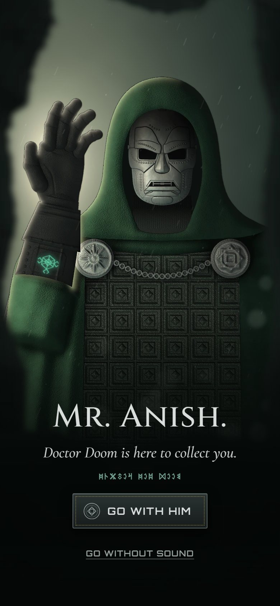
  <br>
  <sub>The opening on a phone, which uses its own upright composition.</sub>
</p>

### 2. The summons

A steel plate from Latveria, addressed to the guest and dated the day their invitation was created. **Take your seat** accepts. **Decline** asks for confirmation first, then closes quietly. A guest who declined can open their link again and accept, up to the end of the day of the screening.

<table>
  <tr>
    <td width="72%">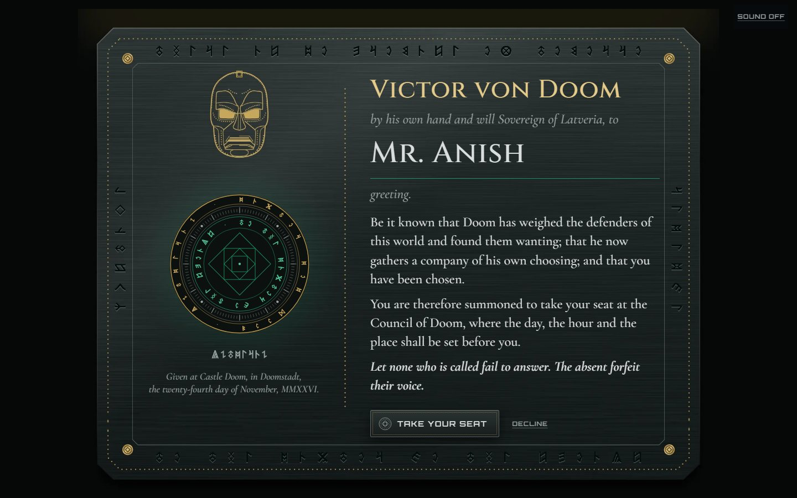</td>
    <td width="28%">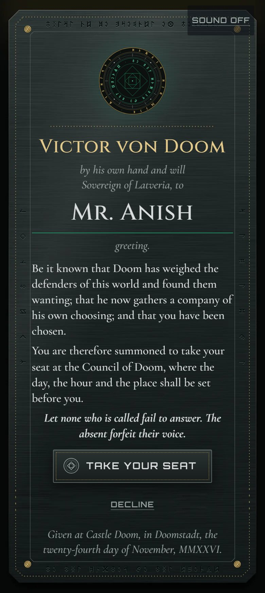</td>
  </tr>
  <tr>
    <td colspan="2" align="center"><sub>The summons on desktop and on a phone.</sub></td>
  </tr>
</table>

### 3. The Council of Doom

Once seated, the guest enters Doom's throne hall and takes part in three steps, one at a time:

1. **Proposal.** Approve Doom's proposed day, hour and venue, or **Propose another** date and time. Everyone sees the count of approvals against seated guests, along with each alternative and who suggested it.
2. **Mantle.** Search the roster and claim a character. Characters already taken stay visible, marked with their holder. **Choose later** skips the step for this visit.
3. **Council.** Everyone summoned, with their status and mantle. The organizer heads the list as the sovereign, holding the mantle of Doctor Doom. **Leave the council** gives up the seat (until the decree).

The link always opens on the first step the guest has not answered. A finished step can be reopened from the step header to change an approval, an alternative or a mantle. The council shows its state when the page loads; a reload shows the latest.

<table>
  <tr>
    <td width="50%">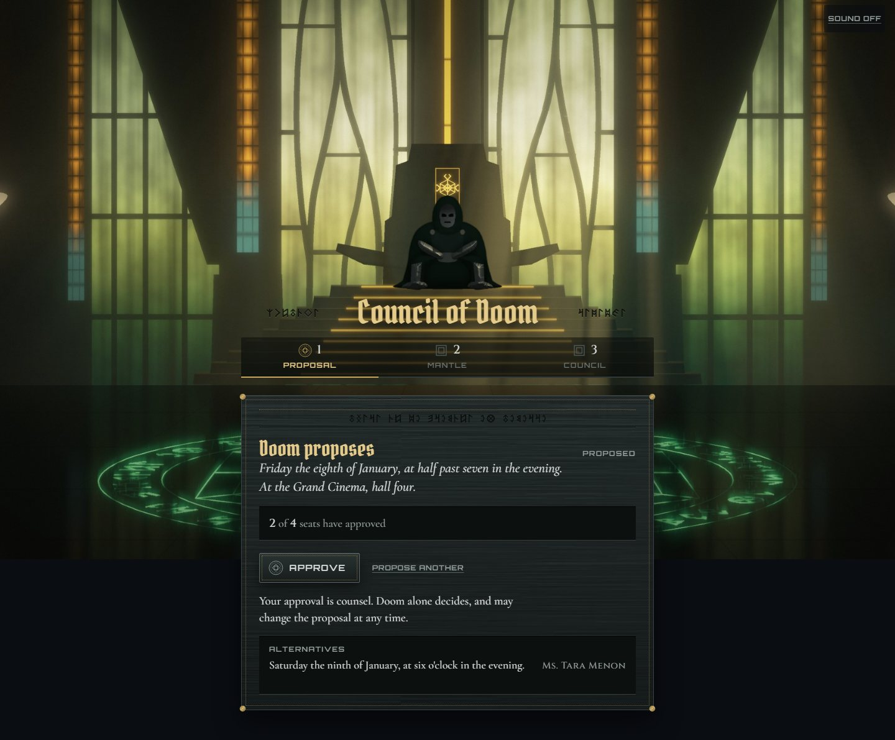</td>
    <td width="50%">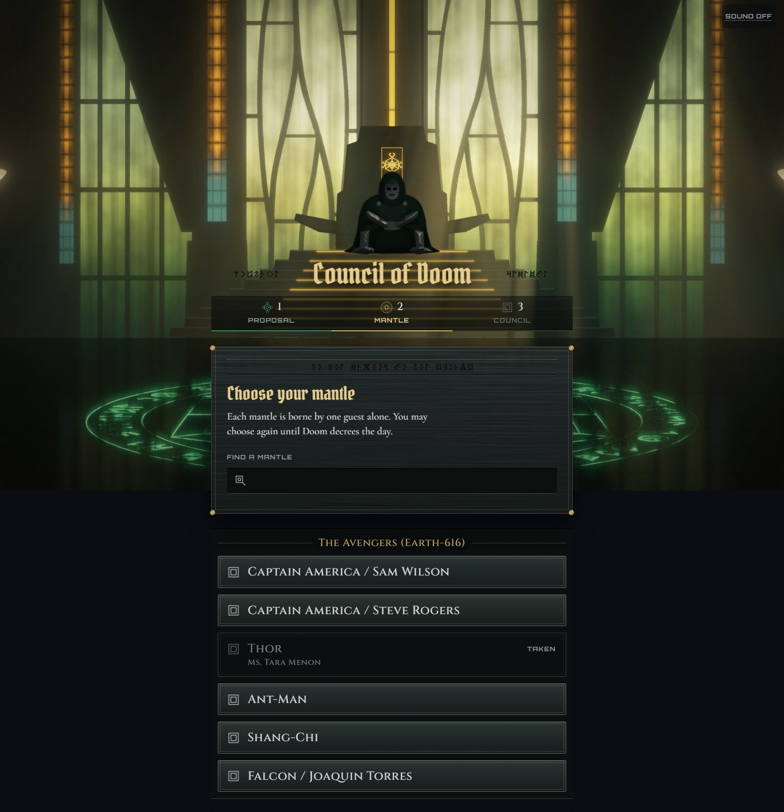</td>
  </tr>
  <tr>
    <td align="center"><sub>Step one: the proposal.</sub></td>
    <td align="center"><sub>Step two: choosing a mantle.</sub></td>
  </tr>
</table>

<table>
  <tr>
    <td width="72%">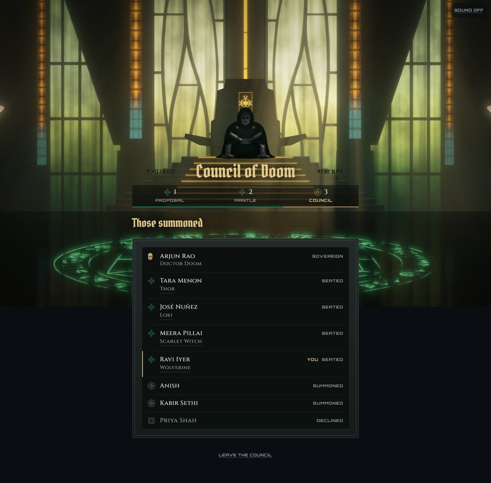</td>
    <td width="28%">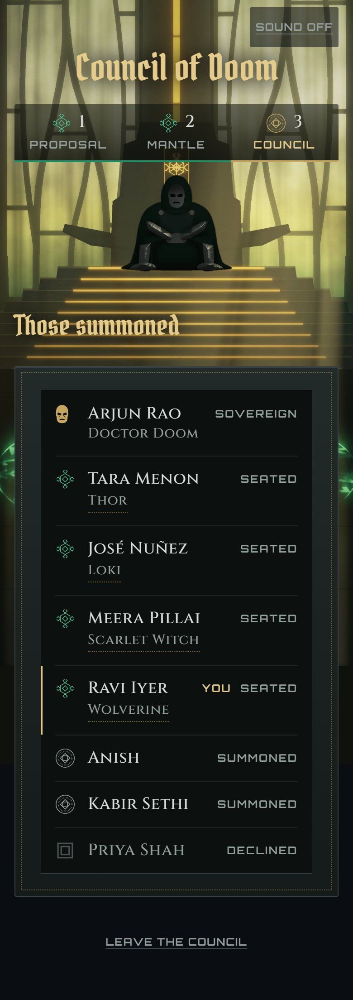</td>
  </tr>
  <tr>
    <td colspan="2" align="center"><sub>Step three: the council, on desktop and on a phone.</sub></td>
  </tr>
</table>

### 4. The decree

When the organizer finalises the plan, the proposal gives way to Doom's decree, with a short ceremony the first time each guest sees it, and again after any amendment. After the decree nobody can approve, suggest, change mantle or leave. Guests who declined never see the plan.

<table>
  <tr>
    <td width="72%">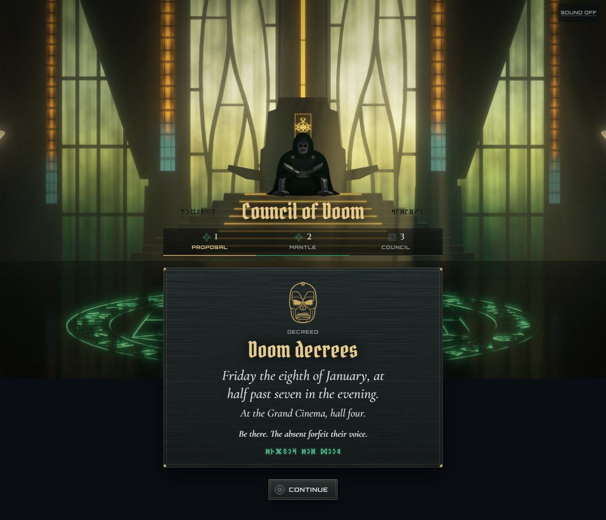</td>
    <td width="28%">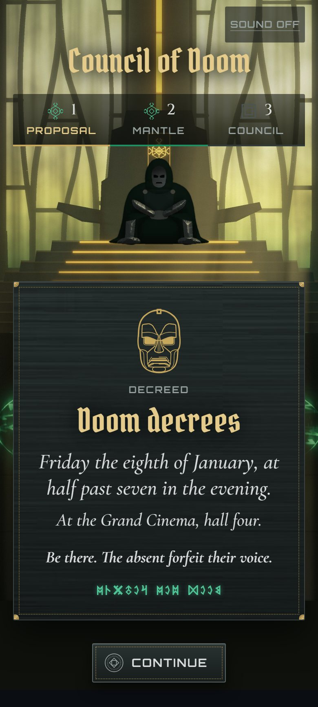</td>
  </tr>
</table>

## Running an event

Organizers sign in at the site's root address and work from the dashboard. Inside an event, the organizer plays Doom.

### Create an account

Open `/` and choose **Create an account** (`/sign-up`): a name, an email and a password of at least six characters. You land on your dashboard (`/dashboard`). Registration is controlled by the deployment ([`ORGANIZER_SIGNUP`](#environment-variables)); when it is closed, `/sign-up` says so and only **Sign in** (`/sign-in`) works.

<table>
  <tr>
    <td width="50%">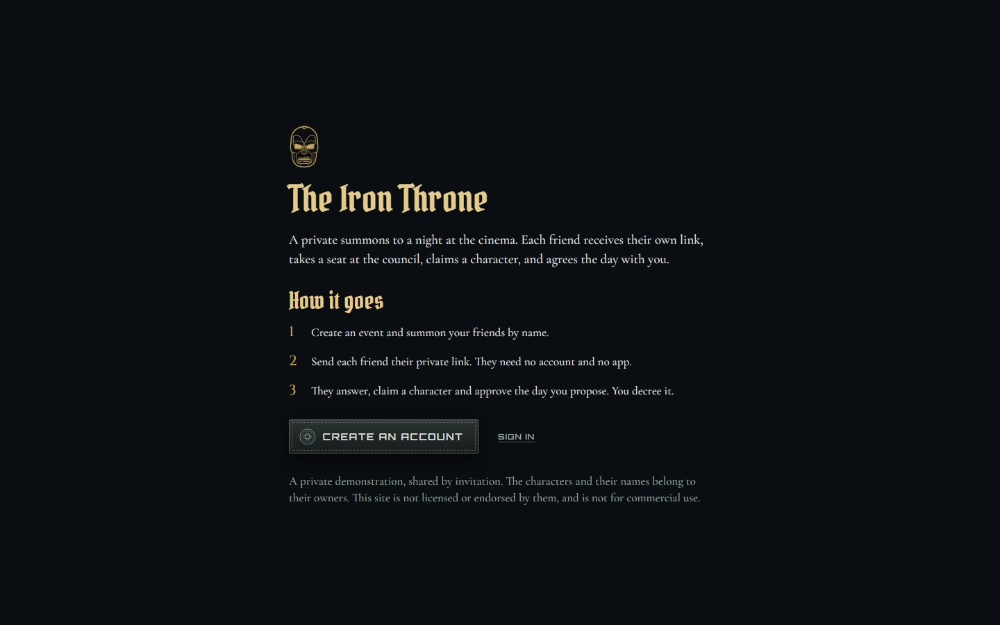</td>
    <td width="50%">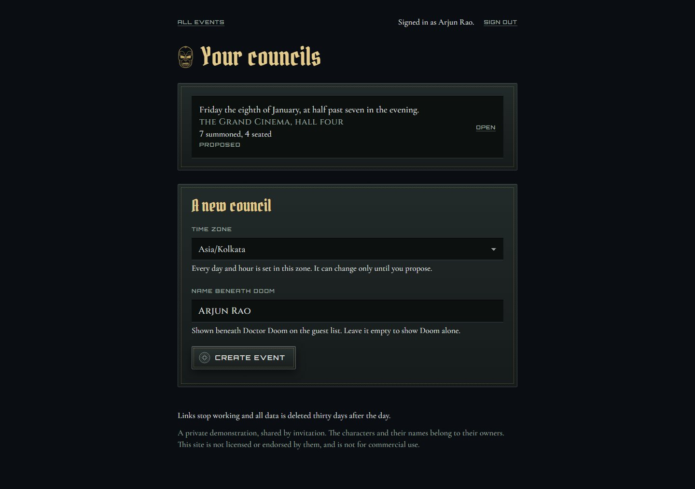</td>
  </tr>
  <tr>
    <td align="center"><sub>The landing page.</sub></td>
    <td align="center"><sub>The dashboard.</sub></td>
  </tr>
</table>

### Create an event

Under **A new council**, choose:

- **Time zone.** Every day and hour is set in this zone. It starts as your browser's zone and can change only until you propose a day.
- **Name beneath Doom.** The name shown with Doctor Doom at the head of the guests' council list. It starts as your name; leave it empty to show Doom alone.

**Create event** opens the event on its proposal. Events have no names: the dashboard tells them apart by their day and venue. Each new event starts with the full Doomsday roster.

### The event panel

Each event lives at `/dashboard/{event}` and has five sections, in the order you'll use them:

| Section | What you do there |
|---|---|
| **Proposal** | Set the day (a date), the hour (on the quarter hour) and the venue. This comes first: guests can only be summoned once a day is proposed. Changing the proposal later clears every approval, after a warning saying how many. After the decree, this is where you **amend the plan**; guests are shown that it changed. |
| **Characters** | Add characters under a faction, or remove them. Removing a character someone holds warns you, then sends that guest back to choose again. You can't assign characters: guests choose for themselves. |
| **Guests** | **Summon a guest** with a name (shown exactly as typed, in capitals and small capitals) and a title (Mr., Ms., Dr. or none). Each guest gets a status (summoned, opened, seated or declined), their mantle, and controls to **copy link**, **replace link** (the old one stops working at once), **cancel link**, **edit name** and **remove guest**. |
| **Council** | The proposal with the number of seated guests who approve and their names (visible only to you), the guests' alternatives, **Finalise the plan**, and **Export**, which downloads the whole event as JSON for safekeeping. To adopt an alternative, change the proposal to it. |
| **Settings** | Change the name beneath Doom, or the time zone before a proposal exists. **Delete event** removes every guest, link, character, approval and alternative at once, after a confirmation. |

<table>
  <tr>
    <td width="50%">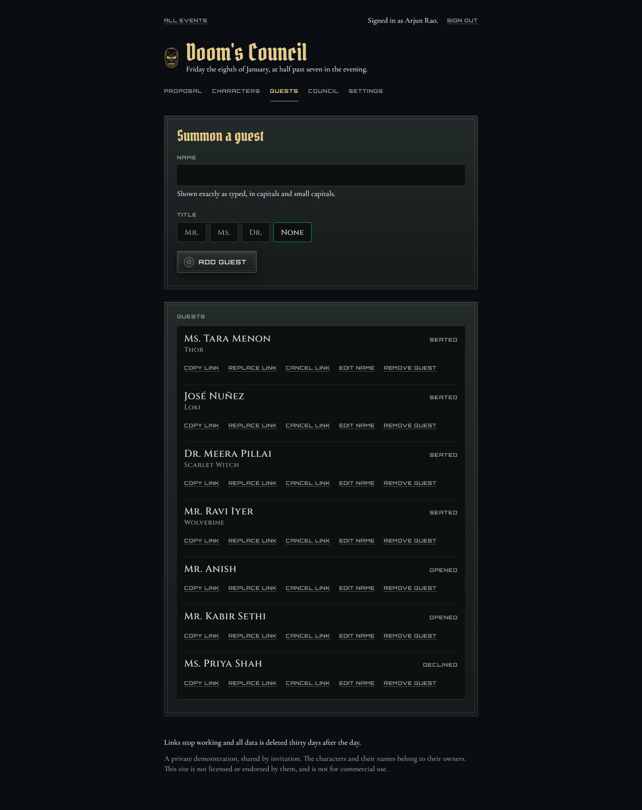</td>
    <td width="50%">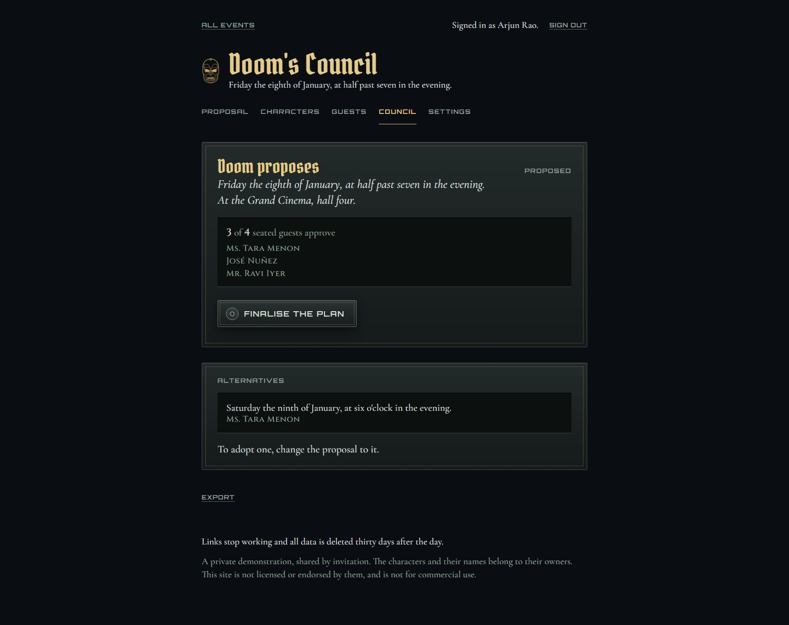</td>
  </tr>
  <tr>
    <td align="center"><sub>Summoning guests and managing links.</sub></td>
    <td align="center"><sub>Approvals, alternatives and the decree.</sub></td>
  </tr>
</table>

### Send the links yourself

The site never sends anything. **Copy link** puts the guest's private address (`/s/…`) on your clipboard with the message *"Link copied. Send it yourself."* Share it however your group talks. If a link reaches the wrong person, **replace link** gives the guest a new one and the old one stops working immediately.

Guests learn of changes (a new proposal, an amended decree) from a notice the next time they open their link.

### After the screening

Thirty days after the day of the screening, the event's links stop working and all of its data is deleted by a daily job. Organizer accounts are not deleted. Any unknown, cancelled or expired link shows the same screen, *"No summons here."*, which reveals nothing about the event.

## How it is built

| Layer | Choice |
|---|---|
| Framework | [Next.js](https://nextjs.org/) 16 (App Router), React 19, TypeScript in strict mode |
| Styling | Tailwind CSS v4 over CSS custom-property tokens, plus hand-written CSS |
| Motion and sound | GSAP with its React hook; the Web Audio API for an original, synthesised score |
| Accounts | [Better Auth](https://www.better-auth.com/): email and password, sessions stored in PostgreSQL |
| Data | PostgreSQL 18 ([Neon](https://neon.tech/) in production, Docker locally), Drizzle ORM over `pg`, Zod validation |
| Tests | Vitest against a real PostgreSQL; Playwright end to end on desktop and phone, with axe accessibility scans |
| Hosting | Vercel, deployed only by GitHub Actions; one daily Vercel Cron job for retention |

```
 Guest's browser                          Organizer's browser
   /s/{token}                               /dashboard, /sign-in
        |                                          |
        v                                          v
 +------------------------------------------------------------+
 | Vercel                                                     |
 |   CDN: artwork, fonts, audio and built assets              |
 |   Next.js (Node.js functions)                              |
 |     Server Components   read state and render              |
 |     Route Handlers      check access, validate, call       |
 |     Domain module       every rule, no framework imports   |
 |     Drizzle             queries, scoped to one event       |
 |   Vercel Cron (daily) -> /api/cron/retention               |
 +-----------------------------+------------------------------+
                               | pooled connection, TLS
                        Neon PostgreSQL
```

A few principles hold throughout:

- **Rules live in one place.** Pages only read. Route Handlers check access, validate input with Zod and call a single function in `web/src/domain/`, which holds every product rule with no framework imports.
- **The database enforces what matters.** A guest's character is unique per event, so a claim is a single `UPDATE` and a lost race comes back as a clear "just taken". Approvals carry the proposal's version, so changing the proposal resets them without touching rows.
- **Every event is isolated.** Every organizer route checks the session and the event's owner on the server. Someone else's event, a missing one and a malformed address all answer the same 404.
- **Words come from the copy deck.** Every user-facing line is in `web/src/copy/`, keyed by its line number in [`docs/COPY.md`](docs/COPY.md).

The visual language rests on three ideas: science, sorcery and sovereignty, each with one colour (steel and silver, emerald, antique gold). Type is set in Pirata One, Cinzel, Orbitron and Cormorant Garamond, with strict usage rules. The full system is in [`design/DESIGN.md`](design/DESIGN.md).

### Project structure

```
doomsday-invitation/
├── docs/                 product spec, copy deck, architecture, launch runbook, screenshots
├── design/               design specification, approved boards and artwork sources (not deployed)
├── research/             creative and background research
├── references/           reference images, never shipped
├── .github/workflows/    ci.yml: checks, previews and production
└── web/                  the application, and the only folder that is deployed
    ├── drizzle/          SQL migrations
    ├── public/           approved artwork, icons and audio
    ├── scripts/          environment setup, migrations, seeding, asset and sound tools
    ├── src/
    │   ├── app/          routes: /, /sign-in, /sign-up, /dashboard, /s/[token], /api
    │   ├── domain/       product rules: events, guests, characters, proposal, retention
    │   ├── db/           schema, client, migration runner, TLS
    │   ├── scenes/       the opening, the summons, the council and the hall
    │   ├── components/   shared components, the organizer panel, guest controls
    │   ├── copy/         every user-facing string, keyed to docs/COPY.md
    │   ├── lib/          auth, access checks, sound, motion, time zones
    │   ├── styles/       design tokens and component styles
    │   └── fonts/        the four typefaces, with their licences
    └── tests/            domain, handler, database and end-to-end tests
```

## Getting started

### Prerequisites

- **Node.js 22.12 or later**, with npm.
- **Docker Desktop**, running. It provides the local PostgreSQL 18 database and is needed for the tests.
- Python 3 only if you regenerate artwork or sounds. It isn't needed to run the app.

### Run it locally

All commands run from `web/`.

```bash
cd web
npm ci

# Start the local PostgreSQL 18 (port 54329).
docker compose up -d

# Create .env.local: points at the local database and generates the secrets.
# It prints variable names only, never values.
npm run env:setup

# Apply the migrations.
npm run db:migrate

npm run dev
```

Open <http://localhost:3000>, create an account at `/sign-up` (registration is open in development by default), and create your first event.

To explore without setting anything up by hand, the seed command creates a sample event with guests in every state and prints their local links:

```bash
# Create an account in the browser first, then give the sample event to it:
npm run seed:local -- --owner you@example.com
```

`seed:local` refuses any database that is not on your machine. Be aware that it **empties every event in the local database** before creating the sample, each time it runs.

### Useful commands

| Task | Command |
|---|---|
| Develop | `npm run dev` |
| Production build / serve | `npm run build`, `npm run start` |
| Format, check formatting | `npm run format`, `npm run format:check` |
| Lint and type-check | `npm run lint`, `npm run typecheck` |
| Unit, integration and handler tests | `npm test` |
| End-to-end tests (builds first) | `npm run e2e` |
| Create a migration after changing `src/db/schema.ts` | `npm run db:generate` |
| Apply migrations | `npm run db:migrate` |
| Check that the configured databases answer | `npm run db:check` |
| Fill the local database with a sample event | `npm run seed:local [-- --owner <email>]` |
| Give ownerless events (made before accounts existed) to an organizer | `npm run organizer:claim -- --email <email> [--host-name "<name>"]` |
| Copy approved assets and fonts into the app | `npm run assets:sync` |

The design foundation (tokens, type and base components) can be checked at `/dev/specimen` in development. It shows the not-found screen in production.

## Environment variables

Set in `web/.env.local` for local work (`npm run env:setup` creates it, and [`web/.env.example`](web/.env.example) documents it), and in Vercel's project settings for preview and production. Never commit real values.

| Name | Needed | Purpose |
|---|---|---|
| `DATABASE_URL` | Required | The application's database. Locally the Docker container; in Vercel, Neon's **pooled** connection string. |
| `DATABASE_URL_DIRECT` | Required for migrations | The direct (unpooled) connection string, used only by `npm run db:migrate`. |
| `SESSION_KEY` | Required | Better Auth's secret for signing and encrypting organizer sessions. At least 32 characters. |
| `BETTER_AUTH_URL` | Required in deployments | The address organizers use: `http://localhost:3000` locally, the production address in Vercel. Vercel's own deployment addresses are accepted too. |
| `ORGANIZER_SIGNUP` | Optional | `open` or `closed`. When unset, registration is open in development and **closed** in production. |
| `CRON_SECRET` | Required in production | Protects `/api/cron/retention`. Vercel sends it as a bearer token to the daily job. |
| `NEON_DATABASE_URL`, `NEON_DATABASE_URL_DIRECT` | Optional, local only | Read only by `npm run db:check`. `env:setup` copies them from a root `.env` if one exists. |

The application reads each setting where it is used and never logs values. A missing setting stops only the feature that needs it.

## Testing

```bash
cd web
npm run format:check && npm run lint && npm run typecheck
npm test        # Vitest: needs the Docker database running
npm run e2e     # Playwright: builds, then runs desktop and phone
```

- **`npm test`** covers the domain rules, every Route Handler, the migrations and the access checks. It runs against a real PostgreSQL: each run creates throwaway databases in the local container, and nothing is mocked. The suite includes a twenty-way concurrent character claim and checks that one organizer can never reach another's event.
- **`npm run e2e`** builds the app, serves it against a fresh local database (`iron_throne_e2e`), and walks the whole journey on a desktop and a phone viewport. That covers the opening, summons, council, decree and organizer panel, plus keyboard-only use, reduced motion, sound, privacy headers and axe accessibility scans (WCAG 2.2 AA). Before the first run, install the browser with `npx playwright install chromium`.

Tests never read `.env.local`, so they can't reach a real deployment's database.

## Deployment

Nothing is deployed by hand. [`web/vercel.json`](web/vercel.json) switches off Vercel's own Git deployments, so [`.github/workflows/ci.yml`](.github/workflows/ci.yml) is the only route to Vercel:

- **Every pull request and every push to `main`** runs formatting, lint, type-check, Vitest and Playwright against a PostgreSQL 18 service container.
- **A pull request** migrates the Neon `preview` branch and deploys a protected preview, then smoke-tests it.
- **A push to `main`** builds and stages a production deployment that serves no traffic yet. The workflow then backs up the production database, applies pending migrations under an advisory lock, and smoke-tests the staged deployment. Only after that does it promote it. If any step fails, the live site is untouched.

GitHub Actions holds `VERCEL_TOKEN`, `VERCEL_ORG_ID`, `VERCEL_PROJECT_ID`, `PRODUCTION_DATABASE_URL_DIRECT` and `PREVIEW_DATABASE_URL_DIRECT` as secrets. Vercel holds the [environment variables](#environment-variables) for each environment. Migrations are written to be backward compatible, so the previous deployment keeps working during a release.

[`docs/LAUNCH.md`](docs/LAUNCH.md) is the runbook for launch, real-phone checks and the platform migration. [`docs/ARCHITECTURE.md`](docs/ARCHITECTURE.md), section 8.4, describes the pipeline in full.

## Security and privacy

- **Guest links** carry 256-bit random tokens. Unknown, cancelled and expired links all get the same 404, and repeated failed lookups from one address are locked out for fifteen minutes.
- **Organizer accounts** use Better Auth: hashed passwords, a signed `HttpOnly`, `SameSite=Strict` session cookie backed by a database row (so signing out ends the session), Origin checks on every change, and attempt limits counted in the database (10 sign-ins per 15 minutes, 5 sign-ups per hour, per address).
- **Isolation.** Every organizer request is checked on the server for a live session and ownership of the event. Every event-scoped query is filtered by event.
- **No third parties.** Fonts, artwork and audio are self-hosted. A strict Content Security Policy allows only the site's own origin. There are no analytics or trackers.
- **Not indexed.** `robots.txt` disallows everything, every response carries `X-Robots-Tag: noindex, nofollow`, and every link previews identically, naming no one.
- **Retention.** Each event and everything in it is deleted thirty days after its day.

## Limitations

- **No email.** There is no email provider, so there's no email verification and no password reset. The site never sends invitations; organizers share links themselves.
- **The council doesn't update live.** Guests see the latest state when they load or reload the page.
- **Approval is advisory by design**, and the approval rules are expected to change. They are kept in one place (`web/src/domain/approval.ts`).
- **One theme.** The Doctor Doom experience is the only theme, and it stays a private demonstration. Payments, teams, guest accounts, notifications and custom domains are out of scope.
- **The artwork follows studio-owned designs closely**, which is acceptable only because the site is private and unindexed. Nothing from `references/` is ever shipped.

## Documentation

| Document | What it covers |
|---|---|
| [`docs/PRODUCT_SPEC.md`](docs/PRODUCT_SPEC.md) | What the product does: roles, the guest journey, invitation management, the organizer platform, and every product decision |
| [`design/DESIGN.md`](design/DESIGN.md) | How it looks, moves and sounds: palette, typography, the opening, the hall, components, motion and sound |
| [`docs/COPY.md`](docs/COPY.md) | Every word shown to guests and organizers, numbered, with the typeface for each line |
| [`docs/ARCHITECTURE.md`](docs/ARCHITECTURE.md) | Stack, schema, data integrity, API, security, deployment and testing |
| [`docs/LAUNCH.md`](docs/LAUNCH.md) | The launch and production runbook |
| [`docs/HANDOFF.md`](docs/HANDOFF.md) | The project's history and the decisions behind version 1 |
| [`design/EXPERIENCE_AUDIT.md`](design/EXPERIENCE_AUDIT.md) | The experience audit behind the creative refinement |
| [`research/`](research/) | Background research on Doctor Doom, Latveria and the visual references |

Where documents disagree, the product spec governs behaviour, the copy deck governs wording, the design spec governs appearance, and the architecture governs implementation.

## Working on the project

- Read [`AGENTS.md`](AGENTS.md) and [`web/AGENTS.md`](web/AGENTS.md) first. This Next.js version differs from older ones.
- All user-facing text comes from [`docs/COPY.md`](docs/COPY.md) through `web/src/copy/`. Don't write wording inline in components.
- Typography rules are easy to break: no word containing a V in Pirata One, no numerals or names in Orbitron, figures in Cinzel, and no readable body text under 17 px. Dates are always written in words.
- Keep the documents in step with the code: when behaviour, wording or structure changes, update the document that owns it.
- Commits follow [Conventional Commits](https://www.conventionalcommits.org/) (`feat:`, `fix:`, `docs:` and so on), with an imperative subject under about 70 characters.
- Never commit secrets. Local values live in `web/.env.local`, which is git-ignored.

## License

No license has been granted for this repository: it is a private project, and all rights are reserved. The bundled typefaces (Cinzel, Cormorant Garamond, Orbitron and Pirata One) are used under the SIL Open Font License; their licence files are in [`web/src/fonts/`](web/src/fonts/). Doctor Doom, Latveria, *Avengers: Doomsday* and the characters on the roster belong to their respective owners.
